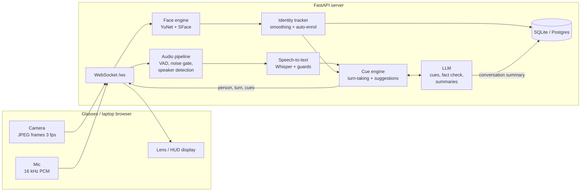

# Social Cue Glasses

**Real-time social assistant for smart glasses.** It recognizes the person you're talking to, remembers your past conversations with them, and shows short live cues on the lens: who they are, when it's your turn to speak, their emotional tone, and reply suggestions when you get stuck.


> **Status:** A working laptop prototype that runs end to end: webcam and mic in, live HUD captions out. Porting to glasses hardware is in progress. See [Roadmap](#roadmap).

<!-- Add a demo GIF or screenshot here, e.g. docs/demo.gif -->

---

## Why

Remembering names, picking up on social cues and keeping a conversation going are hard for many people, for example people with social anxiety, autism, prosopagnosia (face blindness) or memory difficulties. Social Cue Glasses gives the wearer quiet, glanceable support during a real conversation and stays out of the way when it isn't needed.

## Features

- **Face recognition and memory.** On-device face detection (YuNet) and 128-d embeddings (SFace) are matched against a database of people. Unknown faces are auto-enrolled, and their names are filled in later when someone says them in the conversation.
- **Live transcription with speaker attribution.** WebRTC VAD and an adaptive noise gate (SNR plus pitch check) feed Whisper. Me vs. Them is decided automatically from voice pitch and loudness, with a hold-to-talk fallback. Clicking a transcript line corrects the speaker, and every correction teaches the model.
- **Turn-taking cues.** The lens shows *"Your turn to speak"* when the other person pauses and *"Pause – let them finish"* when you interrupt.
- **Context-aware reply suggestions.** An LLM suggests a reply only when the wearer is actually stuck (5 s of silence or repeated hesitation). If the conversation still stalls, an ice breaker follows. A second LLM pass removes suggestions that invent facts.
- **Hallucination guards on speech-to-text.** The app drops low-confidence segments, echoed lines and implausibly long outputs, and marks unclear lines so the AI doesn't answer things nobody said.
- **Automatic conversation memory.** When a conversation ends, the transcript becomes a structured record (summary, topics, mood, promises made) and the person's profile is merged with what's new (interests, how to talk with them, what to ask next time).
- **People dashboard.** Browse everyone the glasses know, edit profiles, merge duplicates, reassign conversations and export everything as JSON.
- **Hardware-agnostic.** Any device that streams mic and camera over a small [WebSocket protocol](PROTOCOL.md) and draws text can act as the glasses.

## Tech stack

| Layer | Technology |
|---|---|
| Backend | Python, FastAPI, Uvicorn, WebSockets |
| Computer vision | OpenCV DNN: YuNet (detection), SFace (recognition), ONNX on CPU (~5 ms/frame) |
| Audio | WebRTC VAD, custom noise gate, pitch (F0) and loudness speaker model |
| Speech-to-text | Whisper large-v3 via Groq API (OpenAI or local `faster-whisper` optional) |
| LLM | gpt-oss-120b via an OpenAI-compatible API (Groq default; OpenAI or Ollama supported) |
| Storage | SQLite (local) or PostgreSQL (`DATABASE_URL`) |
| Frontend | Vanilla JS, HTML and CSS (live HUD, people dashboard, self-registration) |
| Testing | pytest (83 unit tests, no camera or mic needed) |

## Architecture



The server does all the heavy work. A device only streams audio and video and renders text, so the same backend serves a laptop browser, a phone mirrored to display glasses, or a native glasses app.

## Quick start

**Requirements:** Python 3.10+, a webcam and microphone, and a free [Groq API key](https://console.groq.com).

```bash
git clone https://github.com/<your-username>/social-cue-glasses.git
cd social-cue-glasses

python -m venv .venv
source .venv/bin/activate          # Windows: .venv\Scripts\activate
pip install -r requirements.txt

cp .env.example .env               # Windows: copy .env.example .env
# open .env and set GROQ_API_KEY=gsk_...

python -m server.main
```

Open **http://localhost:8000**, click **Start** and allow camera and mic access. Then click **Set up my voice** and talk normally for 5 seconds (one-time calibration). You can also switch *Who is speaking* to **Manual** and hold Space while you talk.

The first run downloads the two face models (~40 MB) into `data/models/`.

| Page | Purpose |
|---|---|
| `/` | Live view: camera, glasses HUD, transcript |
| `/people` | Everyone the glasses know, their profiles and conversation history |
| `/register` | Self-registration for a new face (links to an auto-created record if one exists) |

Run the tests:

```bash
python -m pytest -q
```

## How it works

1. **Face.** Frames at 3 fps go through YuNet detection and SFace embedding, then a cosine match against the gallery. A face seen clearly about 5 times in 1.5 s is auto-registered as "Person N". New angles are added to the person's gallery, so recognition improves over time.
2. **Speech.** VAD finds speech, and a noise gate checks that it is clearly louder than the room's adaptive noise floor and contains voice pitch. Fans, keyboard noise and distant chatter never reach Whisper. A turn ends after 0.7 s without voice.
3. **Speaker attribution.** Each utterance's pitch and loudness are compared against the wearer's calibrated voice and a learned profile of the other person. Hold-to-talk always overrides the automatic decision.
4. **Live cues.** Suggestions are triggered by real hesitation, not by every line. They use only the last 12 turns plus the person's profile, are checked by a second model for invented facts, and disappear once the wearer responds or the topic changes.
5. **After the conversation.** After 25 s with no face and 20 s of silence, or when the user clicks *End conversation*, the LLM writes a structured conversation record and updates the person's profile without overwriting existing entries.

## Data model

**Person:** name, face photo, first met / last seen, how you know them, role, interests, how to talk with them, things to ask next time, your private notes, latest summary.

**Conversation:** timestamp, duration, title, summary, topics, mood, key points, promises/plans, full speaker-labelled transcript.

Raw audio and camera frames are never stored. Face embeddings stay in the database but are never exported or shown.

## Project layout

```
server/
  main.py       FastAPI app: pages, REST API, WebSocket
  session.py    per-device session that ties all components together
  face.py       YuNet + SFace face engine (ONNX, CPU)
  identity.py   identity smoothing and auto-registration
  audio.py      VAD, noise gate, turn-taking, speaker detection, hold-to-talk
  stt.py        Whisper (API or local) with accuracy guards
  cues.py       when to show suggestions, ice breakers and turn hints
  llm.py        OpenAI-compatible client: live cues, fact check, summaries
  prompts.py    all LLM prompts
  store.py      people, faces, conversations (SQLite or Postgres)
  config.py     every threshold and model name, overridable by env vars
web/            Live HUD, People dashboard, Register page
tests/          pytest suite
PROTOCOL.md     WebSocket protocol for any glasses client
```

## Deployment options

| Stage | Server runs on | Database |
|---|---|---|
| Laptop demo | Laptop | SQLite `data/glasses.db` (default) |
| Glasses on the same Wi-Fi | Laptop | SQLite |
| Glasses on mobile data / multiple users | Cloud host (Render, Railway, VPS) | Managed Postgres, set `DATABASE_URL=postgresql://...` |

Tables are created automatically. Faces are matched in memory, so a remote database doesn't slow down live captions.

**Connecting glasses hardware:**

| Glasses type | Approach |
|---|---|
| Display glasses mirroring a phone (XREAL, Viture, Rokid Max) | Open the page on the phone in *Glasses view only* mode (black renders as transparent) |
| Android-based glasses with camera and mic (Vuzix, Rokid, INMO) | Use the browser in HUD mode, or a native client following [`PROTOCOL.md`](PROTOCOL.md) |
| SDK glasses with a phone companion app | Forward mic PCM (`0x01`) and JPEG frames (`0x02`) over the WebSocket; render `person`, `turn` and `cues` events |

Camera and mic access from another device on Wi-Fi requires HTTPS:

```bash
SSL_CERTFILE=cert.pem SSL_KEYFILE=key.pem python -m server.main   # e.g. certs from mkcert
```

## Configuration

Every threshold can be overridden with environment variables (see [`server/config.py`](server/config.py) and [`.env.example`](.env.example)). The most useful ones:

| Problem | Setting |
|---|---|
| Wrong person recognized | Raise `FACE_MATCH_THRESHOLD` (0.42 → 0.48) |
| Phantom lines from background noise | Raise `SPEECH_MIN_SNR_DB` (8 → 11) |
| Quiet speaker missed | Lower `SPEECH_MIN_SNR_DB` (8 → 6) |
| "Your turn" too eager or too slow | `YOUR_TURN_MS` (default 1200) |
| Sentences cut in half | `END_OF_TURN_MS` (700 → 900) |
| Suggestions too rare / too frequent | `CUE_MIN_WORDS`, `CUE_MIN_CONF` |
| Slow captions or rate-limit warnings | Smaller `LLM_MODEL`, lower `CUE_CONTEXT_TURNS` |
| Hindi / Hinglish | `STT_LANGUAGE=` (empty means auto-detect) |
| Fully offline | `STT_PROVIDER=local` + Ollama for the LLM |

> Groq's free tier limits tokens per minute. In a fast conversation some cues may be skipped with a rate-limit warning.

## Roadmap

- [x] Face detection, recognition and auto-enrolment
- [x] Noise-robust transcription with hallucination guards
- [x] Automatic Me/Them speaker attribution (pitch and loudness)
- [x] Turn-taking cues and hesitation-triggered reply suggestions
- [x] LLM fact-check pass on suggestions
- [x] Post-conversation summaries and evolving person profiles
- [x] People dashboard with merge, edit and JSON export
- [x] SQLite / Postgres storage
- [ ] Port to physical smart-glasses hardware
- [ ] Facial-expression model for emotion (currently inferred from words)
- [ ] Neural voice-print speaker ID (for similar-sounding voices)
- [ ] Group conversations with more than one other person

## Privacy and ethics

This system processes biometric and conversational data about people other than the user. It stores face embeddings, a small face photo, and conversation summaries and transcripts. Raw audio and video are never saved. Speech clips and transcripts are sent to the configured API provider (Groq by default) for processing.

If you use it:

- Tell people they are being recognized, and let them self-register or delete themselves at `/register` and `/people`.
- Follow local consent laws. In India, this data falls under the **Digital Personal Data Protection Act, 2023**.
- Set `AUTO_REGISTER=false` to turn off automatic enrolment.
